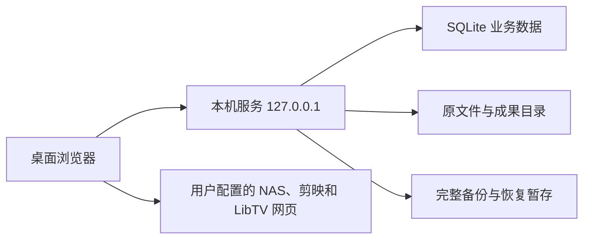

# 企业 AI 内容生产平台开发计划

| 项目 | 内容 |
| --- | --- |
| 计划版本 | 1.0 |
| 编制日期 | 2026-11-07 |
| 需求依据 | PRD.md 1.0 与 v3 页面方案 |
| 执行方式 | 按任务编号顺序交付，每项包含实现、验证和 Git 提交 |
| 工作量假设 | 1 名熟悉 TypeScript 的全栈开发者，兼任基本测试与交付 |
| 基准工作量 | 33 人日 |
| 预留缓冲 | 5 人日，用于本机环境适配、媒体兼容与验收修正 |
| 参考周期 | 38 个工作日，约 7–8 周，按实际投入和反馈时间调整 |

技术选型、目录、接口名称、任务拆分和工作量均为本计划提出的实施建议。产品功能与范围执行已确认的 PRD。开发从 T01 开始，每完成一项就更新任务状态、验证结果与对应提交。

需求与设计依据放在当前工作区。[PRD.md](<E:/AI Creative Workbench/PRD.md>)、[v3 页面说明](<E:/AI Creative Workbench/设计方案/v3/页面结构与交互设计-v3.md>)、[八页结构总览](<E:/AI Creative Workbench/设计方案/v3/00-八个页面结构总览.png>)。

## 1. 交付目标与执行原则

首版交付一个可在 Windows 本机启动、通过桌面浏览器使用的内容生产平台。八个模块形成真实的数据联动，资料管理、原文件、草稿、顺序、参数和历史使用本机持久存储。AI、LibTV、连接器同步和最终视频合成按 PRD 提供带标识的演示。

开发顺序先建立可恢复的数据基础，再逐步增加业务功能。每个里程碑交付可检查的入口、操作和证据。

- 统一使用稳定 ID 关联资源，创建、复制、归档和导入各有明确语义。
- 页面显示保存成功时，服务端已完成持久写入。
- 业务数据、原文件和运行历史按同一个数据集管理。
- 当前编辑引用和历史文件保留分开处理，历史记录持有当时的输入快照。
- 共用配置只有一个来源，工作室、连接器、工作流和设置读取同一份数据。
- 每项任务按照 AGENTS.md 更新相关测试，验证通过后创建对应 Git commit。
- 任务状态使用待开始、进行中、验证中、已完成、待处理。完成记录包含提交号和证据路径。

## 2. 技术方案

### 2.1 技术选型

| 层次 | 计划采用 | 实施说明 |
| --- | --- | --- |
| 运行环境 | Node.js 24 LTS、npm | 在 T01 固定本机补丁版本，在 T02 记录 engines 与锁文件 |
| 前端 | React、TypeScript、Vite | 桌面单页应用，按八个模块组织代码 |
| 页面路由 | React Router | 路由保存模块、详情对象与查询条件 |
| 服务端数据访问 | TanStack Query | 管理读取、写入后的失效更新与错误状态 |
| 样式与图标 | CSS Modules、CSS 变量、Lucide 图标 | 根据 v3 建立颜色、间距、面板、按钮和排版规范 |
| 本机服务 | Fastify、TypeScript | 提供业务 API、媒体文件、备份下载与静态页面 |
| 结构化存储 | SQLite、better-sqlite3 | 使用迁移、外键、事务和数据库备份 API |
| 文件存储 | 本机受控文件目录 | 原文件以 fileId 定位，流式上传与读取 |
| 完整备份 | Archiver、yauzl | 流式生成和读取 ZIP64，包内带清单及文件校验值 |
| 功能验证 | Vitest、Fastify 注入测试、Playwright | 覆盖业务规则、真实本机文件与浏览器入口 |

截至计划编制时，Node.js 官方仍将 24 列为 LTS。实际开发先验证 Windows 上的依赖安装与 SQLite 驱动，再将通过验证的精确版本写入锁文件。[Node.js 发布状态](https://nodejs.org/en/about/previous-releases)、[better-sqlite3 项目说明](https://github.com/WiseLibs/better-sqlite3)。

React 官方提供 Vite 的 TypeScript 初始化路径，并列出路由和服务端数据读取的配套方案。本计划据此选择上述前端组合。[React 从头构建应用](https://react.dev/learn/build-a-react-app-from-scratch)、[Vite 入门](https://vite.dev/guide/)。

Fastify 提供本机 HTTP 服务和请求验证入口。API 统一使用 JSON Schema 验证输入，前后端在 shared 中复用类型与枚举。[Fastify 入门](https://fastify.dev/docs/latest/Guides/Getting-Started/)。

### 2.2 本机运行方式



正式本地使用固定访问 `http://127.0.0.1:4173`。本机服务同时提供构建后的前端、API 与媒体读取，开发时由 Vite 代理 API。

提供“启动平台.cmd”作为双击入口。启动脚本从自身位置确定项目根目录和数据目录，后台进程使用隐藏窗口。检测已有实例时验证应用标识，再打开浏览器。端口被其他应用占用时给出处理提示。

停止脚本只处理本应用登记并验证的进程。首次依赖安装与浏览器测试环境准备在开发阶段完成。日常启动使用已安装依赖和已构建资源。

### 2.3 计划中的工程目录

以下目录由 T02 及对应任务创建。

```text
E:\AI Creative Workbench\
  PRD.md
  DEVELOPMENT_PLAN.md
  AGENTS.md
  package.json
  package-lock.json
  apps\
    web\src\
      app\
      components\
      features\home\
      features\agents\
      features\studio\
      features\assets\
      features\connectors\
      features\skills\
      features\workflows\
      features\settings\
    server\src\
      routes\
      services\
      db\migrations\
      storage\
      demo\
  packages\shared\src\
  fixtures\demo\
  scripts\
  tests\
    integration\
    e2e\
  dist\
  data\
  启动平台.cmd
```

根目录使用 npm workspaces 管理 web、server 和 shared，保持一份依赖锁文件。运行数据目录、测试临时目录、构建结果和测试报告加入 Git 忽略规则。每次构建保留 data 中已有文件。

### 2.4 数据目录与数据集

默认数据根目录为 `E:\AI Creative Workbench\data`。允许通过 `APP_DATA_DIR` 指定其他本机位置，启动后显示实际使用位置。

```text
data\
  active.json
  activation-journal.json
  datasets\
    <datasetId>\
      database.sqlite
      files\<fileId>\original.<ext>
      previews\<fileId>\
  staging\
    uploads\
    backups\
    restores\
  backups\
  logs\
```

`active.json` 指向当前完整数据集。恢复在新数据集目录中完成，验证成功后切换指向。切换记录和旧数据集用于异常恢复。数据库运行生成的 SQLite 日志文件由对应连接正常管理。

文件原件按 fileId 保存，原名称记录在数据库。修改名称和标签更新元数据，文件内容通过新 fileId 保存版本。预览文件可重新生成，原文件与成果文件参与完整备份。

## 3. 数据、接口和一致性约定

### 3.1 最少数据模型

| 表或数据组 | 主要字段 | 用途 |
| --- | --- | --- |
| agents | id、name、purpose、domain、origin、author、instructions、exampleDialog、createdAt、updatedAt | 团队智能体 |
| skills | id、name、scenario、origin、skillType、inputSpec、steps、outputSpec、examples、externalRef | 团队方法与 LibTV 技能引用 |
| products | id、name、sku、description、sellingPoints、packageVersion、notes | 商品知识 |
| files | id、relativePath、originalName、mimeType、size、sha256、duration、width、height、state | 真实文件与媒体信息 |
| assets | id、name、assetType、fileId、origin、provenance、tags、notes、createdAt、updatedAt | 文件、媒体与成果目录 |
| case_collections、collection_items | 集合说明、分类、assetId | 案例归档和成员引用 |
| drafts | id、creationType、name、requirements、parameters、agentId、workflowId、revision、saveState | 创作草稿与修订号 |
| draft_clips | draftId、assetId、position | 简单视频拼接顺序 |
| team_workflows | id、name、purpose、origin、author、libtvRef、inputSpec、defaultParameters、coverFileId | 团队工作流 |
| connectors | id、serviceType、name、demoConfig、enabled、simulationStatus | 连接器配置 |
| runs、run_items | owner、kind、status、inputSnapshot、parameters、demo、result、itemStatus、startedAt、finishedAt | 制作、流程与同步演示记录 |
| run_files | runId、fileId、role | 历史记录保留的真实文件 |
| settings | key、value、updatedAt | NAS、LibTV、剪映和界面偏好 |
| activities、recent_items | 动作、资源标识、显示快照、时间、示例标记 | 首页动态和最近使用 |
| seed_state、schema_migrations | 示例版本、迁移版本与时间 | 幂等初始化和数据升级 |

关系表按明确对象建立，例如 agent_skills、agent_assets、agent_products、draft_assets、draft_skills 和 workflow_skills。所有关系写入先验证目标存在，并与业务记录在同一数据库事务内提交。

公共枚举使用 `owned/shared` 表示来源，`seed/user_import/demo_result` 表示资料出处。技能类型使用 `platform/libtv_reference`。创建和复制生成新 ID，复制结果归本机用户所有。

历史记录保存当时名称、参数和文本快照。run_files 保留成果依赖的原文件。删除现行资源时检查当前引用，历史仍需要的文件继续保留。

### 3.2 API 任务清单

| API 组 | 计划提供的操作 | 完成任务 |
| --- | --- | --- |
| /api/system | 健康状态、实际数据目录、数据集标识、版本、容量信息 | T02、T03、T22 |
| /api/files | 上传、文件信息、内容读取、下载、预览信息 | T04 |
| /api/assets、/api/products、/api/collections | 查询、创建、编辑、删除、集合引用 | T09、T10 |
| /api/skills、/api/agents | 查询、编辑、复制、关联与详情 | T11、T12 |
| /api/workflows | 团队目录、LibTV 示例、默认参数、复制与保存 | T13、T14 |
| /api/connectors | 目录、配置、启停、演示记录和示例导入 | T15 |
| /api/drafts | 创建、修订保存、资源引用、片段排序、历史 | T16、T19 |
| /api/runs | 创建演示、读取进度、停止、结果和批量条目 | T14、T17、T18 |
| /api/results | 归档、导入外部成片、另存团队流程 | T20 |
| /api/home、/api/search | 统计、共享内容、动态、最近使用和分组搜索 | T21 |
| /api/settings | 共用入口和显示偏好 | T10、T22 |
| /api/backups、/api/restores | 导出、校验、预览、确认与恢复状态 | T06、T07 |

单条资源使用 ID 访问。错误返回稳定的 code、message、fieldErrors 和当前数据集标识。引用冲突返回引用位置。草稿修订冲突返回当前版本，界面保留本次输入供处理。

写入操作带当前数据集标识，恢复切换后的旧请求返回 `DATASET_CHANGED`。前端收到后重新加载当前数据集，避免旧页面的自动保存落入刚恢复的数据中。

### 3.3 文件导入与事务顺序

1. 为上传分配 fileId，将内容流式写入 staging，并计算大小和 SHA-256。
2. 完成写入后校验文件，取得可支持媒体的元数据。
3. 将文件移至当前数据集的目标位置。
4. 在短数据库事务中写 files、assets、关联及活动记录。
5. 提交成功后返回资产和可读取地址，前端显示成功。
6. 失败时保留明确的失败状态。启动检查发现未登记文件时将其隔离待处理。

数据库事务集中处理同步数据库操作。流式文件读写在事务前后按状态衔接。媒体读取支持 Range 请求，让长视频能够跳转播放位置。

### 3.4 草稿、演示和重复操作

- 草稿每次变化递增本地修改序号，自动保存按草稿串行提交。后到的旧响应只更新对应已确认版本。
- 内部导航、外部跳转和启动演示前等待当前保存完成。存在待保存内容时，离开页面显示保存选择。
- 每次运行冻结输入快照，界面后续修改进入下一次运行。
- 演示状态使用 queued、running、completed、failed、stopped、interrupted，并在界面显示中文演示状态。
- 停止与完成采用带状态条件的数据库更新，停止后到达的定时回调保持终态。
- 启动时将上次未结束的演示标记为 interrupted，保留输入与日志供重新演示。
- 归档以 runId 与 resultItemId 建立唯一约束。同一批同步样例按运行和条目标识登记导入记录。
- 演示素材使用真实可读取的本地文件。样例身份和演示标识随记录持久保存。

## 4. 完整备份与恢复实施步骤

### 4.1 备份包

```text
backup.zip
  manifest.json
  database.sqlite
  files\<fileId>\original.<ext>
```

清单包含格式版本、应用版本、导出时间、资源数量和每个文件的相对位置、大小与 SHA-256。数据库保留引用关系，包中的文件覆盖当前数据与历史记录需要的全部原文件。

数据库快照使用 better-sqlite3 的 backup 方法。该方法和 SQLite Backup API 为一致数据库副本提供实现依据。[better-sqlite3 API](https://github.com/WiseLibs/better-sqlite3/blob/master/docs/api.md)、[SQLite Backup API](https://www.sqlite.org/backup.html)。

1. 备份服务进入写入协调区，等待当前已接受的写入完成，锁定对应数据集。
2. 创建数据库快照，获取快照对应的文件清单并建立临时保留关系。
3. 释放业务写入协调区，以流式方式生成归档。原文件保持不可变，临时保留期间允许读取。
4. 对归档条目校验大小与哈希，完成包后标记可下载。
5. 归档失败保留失败记录，已完成文件继续可用。结束后释放临时保留关系。

采用支持 ZIP64 的归档选项处理视频备份，并监听目标流的完成和错误事件。解包时逐项读取、限制资源占用和验证文件名。相关能力参考归档库官方资料。[Archiver API](https://www.archiverjs.com/docs/archiver/)、[yauzl 项目说明](https://github.com/thejoshwolfe/yauzl)。

### 4.2 恢复流程

1. 上传备份到 restores 暂存目录，读取并验证清单与版本。
2. 验证压缩条目只落在暂存目录，拒绝绝对路径、越界路径和链接条目。
3. 解包到新的 datasetId 目录，逐项验证文件大小与 SHA-256。
4. 在暂存数据库上运行完整性检查、外键检查、表结构和附件引用检查。
5. 展示导出时间、数量和替换范围，等待用户确认。用户可先导出当前数据备份。
6. 确认时重新核对当前数据集，阻止新的写入，停止演示任务，排空正在提交的写入并关闭旧数据库连接。
7. 写入并持久化激活日志，再更新 active.json，打开新数据库并完成健康检查。
8. 成功后通知前端切换数据集，清空旧查询缓存，重新读取所有记录。
9. 若激活或健康检查失败，按激活日志恢复到旧完整数据集。

在 Windows 本机逐点测试激活日志落盘前后、指针替换前后和新数据库打开失败时的行为。启动逻辑根据日志识别完整的当前或上一数据集，并给出恢复结果。

## 5. 任务总表与依赖

人日包含实现、相关测试、基本验证与提交。以下顺序可直接作为执行队列。

| 编号 | 任务 | 前置任务 | 人日 | 里程碑 |
| --- | --- | --- | --- | --- |
| T01 | 需求基线、环境与测试素材准备 | — | 0.5 | M0 |
| T02 | 工程初始化、本机启动和检查命令 | T01 | 1 | M0 |
| T03 | 数据模型、迁移、配置和示例初始化 | T02 | 1 | M1 |
| T04 | 原文件保存、媒体信息和文件读取 | T03 | 2 | M1 |
| T05 | 引用、事务、历史保留和幂等规则 | T04 | 1.5 | M1 |
| T06 | 完整备份服务与下载 | T05 | 1.5 | M2 |
| T07 | 恢复校验、数据集切换和失败恢复 | T06 | 2.5 | M2 |
| T08 | 八模块框架与公共交互组件 | T02 | 1 | M3 |
| T09 | 商品知识、文件和媒体资产管理 | T05、T08 | 2 | M3 |
| T10 | 案例集合、NAS 与共用外部入口 | T09 | 1 | M3 |
| T11 | 技能目录、正文管理与关联 | T09、T10 | 1 | M4 |
| T12 | 智能体目录、详情和带入创作 | T11 | 1 | M4 |
| T13 | 团队工作流目录与管理 | T11、T12 | 1.5 | M5 |
| T14 | LibTV 示例、参数和演示运行 | T13 | 1.5 | M5 |
| T15 | 连接器配置、模拟同步和样例导入 | T14 | 1 | M5 |
| T16 | 工作室草稿、选择器与跨模块带入 | T07、T12、T14 | 1.5 | M6 |
| T17 | AI 视频、AI 图片演示与历史 | T16 | 1.5 | M6 |
| T18 | 美工交付、附件和版本预览 | T17 | 1 | M6 |
| T19 | 简单视频拼接与剪映入口 | T16、T10 | 1.5 | M6 |
| T20 | 成果归档、来源快照和另存流程 | T17、T18、T19、T13 | 1.5 | M6 |
| T21 | 首页、全局搜索与统一更新 | T15、T20 | 1.5 | M7 |
| T22 | 数据设置、备份恢复界面和偏好 | T07、T10、T21 | 1 | M7 |
| T23 | 端到端、异常、重启与恢复验证 | T22 | 2 | M8 |
| T24 | Windows 交付、操作说明与最终验收 | T23 | 1.5 | M8 |

基准合计 33 人日。缓冲单列 5 人日，按实际出现的问题使用并登记原因。

## 6. 逐项执行内容

### T01 需求基线、环境与测试素材准备

- 阅读 PRD、v3 与 AGENTS.md，将 PRD 39 项验收编号登记到验收记录。
- 检查 Node 24、npm、Git、磁盘写入与本机浏览器。验证 better-sqlite3 在目标 Windows 上安装、打开文件数据库和备份。
- 准备一份商品知识、一张图片、一份 PDF、一份可下载的任意附件、三个时长为 4、6、5 秒的有效视频。视频可使用标为测试素材的色块片段。
- 登记文件大小、哈希、时长及预览结果。业务真人素材在后续使用时由用户实际导入。
- 完成证明为环境记录、fixture 清单、全部 PRD 验收编号与依赖兼容结果。

### T02 工程初始化、本机启动和检查命令

- 建立 npm workspaces、React TypeScript 应用、Fastify 服务及 shared 类型包，固定依赖版本。
- 增加开发代理、生产静态资源服务、健康检查、实际数据目录配置和端口占用反馈。
- 建立 typecheck、test、test:e2e、build、start:local 与 check 命令，测试使用隔离的 APP_DATA_DIR。
- 配置本机服务监听 127.0.0.1，写接口校验本应用的 Host 和来源。文件读取通过服务端生成的 ID 路由定位。
- 完成证明为本机地址能打开空壳页面，健康检查正确，检查命令能运行，重启使用相同数据根目录。

### T03 数据模型、迁移、配置和示例初始化

- 按第 3.1 节建立初始迁移和必要索引，启用外键，记录 schema 版本。
- 建立 active 数据集读取、配置读写和启动检查，确保每次连接使用正确数据集。
- 建立带固定示例 ID 的 seed 事务，区分首次初始化和补充缺失示例，保留用户修改。
- 完成证明为连续启动三次后示例数量一致，更新后重开内容仍在，旧 schema 可按受支持迁移升级。

### T04 原文件保存、媒体信息和文件读取

- 实现上传暂存、完整写入、哈希、最终登记和失败处理，创建 fileId 与资产关联。
- 实现下载、Range 读取、图片视频音频预览，PDF 与文本预览，以及其他格式的信息和下载入口。
- 取得视频时长、尺寸和缩略图，持久保存元数据。测试目录、文件名称覆盖中文、空格与同名文件。
- 完成证明为重新打开应用后仍能查看三个原视频，跳转播放位置有效，下载文件哈希与导入前一致。

### T05 引用、事务、历史保留和幂等规则

- 将创建、修改、关联、活动记录写入放在对应事务中。复制操作生成新 ID 并保留共享原件。
- 实现引用查询和删除阻止，列出仍在使用的草稿、智能体或流程。
- 建立运行快照、历史文件保留和归档唯一约束。验证文件已经写入而事务失败的中间状态。
- 完成证明为重复请求只有一份记录，删除当前引用有提示，历史文件在相关目录记录变动后仍可读取。

### T06 完整备份服务与下载

- 按第 4.1 节实现数据库快照、文件清单、保留关系、ZIP64 归档和下载。
- 保存导出状态、导出时间、记录数量与完整文件清单，支持失败后重新导出。
- 用包含同名附件、草稿、视频顺序、设置和运行记录的数据集生成备份。
- 完成证明为归档内容与数据库快照一致，包内文件校验通过，在备份期间修改资料不会混入错误版本。

### T07 恢复校验、数据集切换和失败恢复

- 实现备份上传、清单验证、暂存解包、数据库检查与恢复预览。
- 实现确认、取消、激活日志、数据集切换、旧写入拒绝和启动恢复。
- 在每个激活边界注入失败或中断，验证新旧文件与数据库始终对应同一完整数据集。
- 完成证明为整包恢复后全部文件和关系可用，取消和损坏包保留原数据，服务重启可完成或回退中断切换。

### T08 八模块框架与公共交互组件

- 建立八个一级路由、图标导航、通用标题、全局搜索入口和演示标识。
- 建立卡片、列表、抽屉、表单、确认框、媒体预览、空状态、字段错误与保存状态组件。
- 将查询条件与当前选择写入路由或持久 UI 状态，详情返回保留筛选与滚动。
- 完成证明为八个入口可访问，主标题符合 v3，键盘可以完成主要表单与确认操作。

### T09 商品知识、文件和媒体资产管理

- 实现商品知识新建编辑、资产导入、标签、来源与类型筛选、文件详情和下载。
- 文件和媒体按内容使用列表或缩略图，详情显示实际类型、大小、来源与备注。
- 实现用于创作的带入参数，先由工作室目标路由接收，T16 接入实际草稿选择。
- 完成证明为本地文件、商品知识和标签可增改查，导入失败与不可预览状态能正确处理。

### T10 案例集合、NAS 与共用外部入口

- 实现案例集合和资产引用，保持一个原文件可属于多个集合。
- 实现 NAS 名称、网页地址或 Windows 路径、备注，提供打开网页与复制路径。
- 建立 LibTV 和剪映入口配置服务，入口未配置时显示可操作提示，网页入口按 http 或 https 校验。
- 完成证明为集合引用可恢复，共用配置服务返回已保存的最新入口，Windows 路径复制完整。其他页面在各自任务中接入同一服务。

### T11 技能目录、正文管理与关联

- 实现创建和共享来源筛选、场景分类、搜索、草稿、正文编辑、复制和删除。
- 正文包含输入、步骤、输出与示例，覆盖视频拆解、AI 图片、美工规范和交付检查。
- 保存平台或 LibTV 引用类型，提供技能引用服务，由 T12、T13 和 T16 接入对应选择和关联入口。
- 完成证明为正文与类型保存、来源筛选、独立复制和刷新恢复通过。SK-01 的完整关联操作在 T12 联调。

### T12 智能体目录、详情和带入创作

- 按 v1 目录职责实现创建、编辑、复制、来源与用途筛选和最近更新排序。
- 详情提供概览、指令、知识与技能、示例对话，使用通用详情标题。
- 去创作传递智能体 ID 与默认关联选择，在 T16 中允许用户调整。
- 完成证明为 AG-01、AG-02 通过，示例对话可查看，去创作传递的智能体 ID 正确。AG-03 的草稿带入在 T16 联调。

### T13 团队工作流目录与管理

- 实现团队目录、创建和共享来源、用途筛选、搜索、封面或步骤预览。
- 实现新建、编辑、复制、删除自己的工作流资料，保留 LibTV 引用、默认参数和流程附件。
- 使用通用工作流详情标题，资源实际名称放在详情内容中。预览操作只读取资料。
- 完成证明为共享流程可预览并复制，副本变动独立，引用和默认参数保存正确。使用入口的参数与运行在 T14 接通。

### T14 LibTV 示例、参数和演示运行

- 建立四个流程样例，分别描述人物贴贴片、人物产品展示、批量换包装和视频去字幕的输入及参数。
- 实现 LibTV 页签、尚未接入状态、输入参数面板、保存为团队流程及批量条目展示。
- 建立有限的演示执行服务，覆盖进度、停止、失败、重试、历史与中断恢复。
- 完成证明为参数随运行保存，样例可复用，停止后终态稳定，演示身份清楚可见。

### T15 连接器配置、模拟同步和样例导入

- 实现 Shopify、Gmail、GitHub 与创作工具目录，配置、启停和模拟状态。
- 使用 T14 的演示状态规则，保存同步条目与日志。
- 将明确确认的样例导入放在独立操作，按批次条目标识保证重复操作稳定。
- 完成证明为 CON-01、CON-02 可执行，停用状态约束生效，资产数量与导入动作一致。

### T16 工作室草稿、选择器与跨模块带入

- 实现四种创作类型的草稿模型、自动保存、保存反馈和输入快照。
- 实现商品、智能体、技能、素材和流程选择器，读到当前最新资源。
- 接入资产、技能、智能体和工作流传入参数，已有草稿时选择加入或新建。
- 实现保存前导航处理、修订冲突处理和已保存后的重开恢复。
- 完成证明为 ST-02 和 DATA-01 中的草稿行为可检查，旧自动保存响应保持正确版本。

### T17 AI 视频、AI 图片演示与历史

- AI 视频实现时长、比例、分镜要求和分镜卡与视频示例。AI 图片实现尺寸、构图、风格、数量和候选版本。
- 使用本地有效媒体建立演示结果，记录每次输入、结果与来源快照。
- 接入开始、停止、再次演示、历史查看和类型对应的必填验证。
- 完成证明为两种类型有不同输入和预览，ST-03、ST-04 可执行。

### T18 美工交付、附件和版本预览

- 实现设计类型、尺寸、文案、参考和交付要求的表单。
- 支持导入预览稿、设计源文件和交付说明，分别展示可预览内容与附件下载。
- 保存每次交付与修改记录，并接入成果归档所需输出。
- 完成证明为导入源文件可下载、预览稿可查看，交付要求与记录重开后完整。

### T19 简单视频拼接与剪映入口

- 实现本地添加和资产选择、缩略图、时长、拖动及上下移动、移除和单片段预览。
- 根据现有片段计算顺序条与总时长，保存位置值和文件引用。
- 使用草稿保存规则接入剪映按钮，配置完成后打开用户配置网页。
- 完成证明为 JOIN-01、JOIN-02、LINK-01 可按 PRD 原步骤检查，返回后草稿与视频可用。

### T20 成果归档、来源快照和另存流程

- 实现各类型结果归档到资产库，保存标签、分类、成果文件和来源快照。
- 为归档和导入外部成片建立幂等处理，历史文件关系随成果保存。
- 另存团队工作流时保留 LibTV 引用、需求和默认参数，允许后续管理自己的流程记录。
- 完成证明为 ST-05、WF-03 可执行，重复点击稳定，原文件和历史关系正确。

### T21 首页、全局搜索与统一更新

- 按 PRD 第 3.1 节实现四项统计，列表和看板复用同一查询条件。
- 实现共享内容、四种快捷操作、最近使用和本机活动，保持来源与示例标识。
- 实现名称、说明、标签搜索与类型分组，打开结果后定位原记录。
- 资源写入后统一使相关列表、首页、搜索和引用计数失效更新。
- 完成证明为 HOME-01 至 HOME-04、NAV-03 可完整操作，数量与目录逐项一致。

### T22 数据设置、备份恢复界面和偏好

- 展示实际数据根目录、文件与记录数量、可获取的容量及最近备份信息。
- 接入 T06、T07 的导出、预览、确认、取消、失败与恢复结果反馈。
- 接入共用配置、侧栏和列表偏好，补充缺失示例及清空确认。
- 完成证明为用户可通过设置页独立完成完整备份与恢复，错误时可保留当前数据继续使用。

### T23 端到端、异常、重启与恢复验证

- 按第 8 节矩阵执行自动化和人工检查，补齐模块边界与跨模块组合操作。
- 对保存失败、空间不足、坏文件、损坏包、修订冲突、演示停止和恢复中断注入可复现故障。
- 在独立数据目录完成刷新、退出浏览器、服务重启和电脑重启验证，记录每一步文件校验值。
- 完成证明为 39 个验收编号均有结果与证据，失败项关闭后重跑受影响用例。

### T24 Windows 交付、操作说明与最终验收

- 完成双击启动、已有实例识别、退出、端口提示及固定数据目录处理。
- 在日常使用入口完成构建后版本验证，检查离线页面、本地媒体和备份恢复。
- 交付启动说明、数据位置、备份恢复说明、示例说明、测试报告和版本提交号。
- 完成证明为用户按操作说明可启动、使用、关闭、重开并恢复资料，全部 PRD 验收有最终结果。

## 7. 里程碑与交付门槛

| 里程碑 | 对应任务 | 阶段人日 | 累计人日 | 可检查交付 |
| --- | --- | --- | --- | --- |
| M0 | T01–T02 | 1.5 | 1.5 | 环境可用、素材齐备、本机入口可启动 |
| M1 | T03–T05 | 4.5 | 6 | 元数据和原文件持久保存，引用与历史正确 |
| M2 | T06–T07 | 4 | 10 | 可导出完整包，恢复失败能保留原数据 |
| M3 | T08–T10 | 4 | 14 | 八模块框架、资产、商品知识、NAS 与外部入口 |
| M4 | T11–T12 | 2 | 16 | 技能与智能体可创建、共享查看、复制和关联 |
| M5 | T13–T15 | 4 | 20 | 团队工作流、LibTV 示例和连接器演示可操作 |
| M6 | T16–T20 | 7 | 27 | 四种工作室场景完成创作到归档与流程复用 |
| M7 | T21–T22 | 2.5 | 29.5 | 首页、搜索、配置和备份恢复界面形成闭环 |
| M8 | T23–T24 | 3.5 | 33 | 39 项验收、重启恢复证据与 Windows 交付 |

M2 的验证通过后继续依赖其数据保护能力的任务。M8 使用构建后的本地启动入口验收，并以实际报告登记已完成内容。

## 8. PRD 验收追踪矩阵

实现任务负责提供可检查功能，验证任务负责执行验收并记录结果。自动化覆盖业务行为，电脑重启与实际外部网页可达性补充人工证据。

| PRD 编号 | 实现任务 | 验证任务 | 检查方式 |
| --- | --- | --- | --- |
| NAV-01 | T08 | T23、T24 | 浏览器依次进入八模块 |
| NAV-02 | T08、T16 | T23 | 标题与路由断言 |
| NAV-03 | T21 | T23 | 搜索、详情和返回操作 |
| HOME-01 | T21 | T23 | 增删资源与看板一致性 |
| HOME-02 | T21 | T23 | 共享文件和团队流程口径核对 |
| HOME-03 | T21 | T23 | 快捷入口与四类资源跳转 |
| HOME-04 | T21、T20 | T23 | 动态、最近使用与归档联动 |
| AG-01 | T12 | T23 | 创建编辑复制与刷新 |
| AG-02 | T12 | T23 | 来源筛选及副本独立性 |
| AG-03 | T12、T16 | T23 | 详情、示例对话和带入工作室 |
| SK-01 | T11 | T23 | 正文保存、类型与引用 |
| REF-01 | T05 | T23 | 当前引用阻止与历史保留 |
| ST-01 | T16、T17、T18、T19 | T23 | 四种表单和预览分别操作 |
| ST-02 | T16 | T23 | 加入当前或新建草稿 |
| ST-03 | T17 | T23 | 两次演示的快照与历史 |
| ST-04 | T14、T17 | T23 | 必填验证和停止竞态 |
| ST-05 | T20 | T23 | 重复归档与来源检查 |
| JOIN-01 | T19 | T23 | 三视频排序、移除、时长 |
| JOIN-02 | T19 | T23、T24 | 重开后顺序与文件检查 |
| LINK-01 | T10、T19 | T23、T24 | 未配置提示及实际网页跳转 |
| ASSET-01 | T04、T09 | T23 | 导入、标签、刷新与文件哈希 |
| ASSET-02 | T04、T09 | T23 | 不支持预览与失败注入 |
| ASSET-03 | T09、T10、T16 | T23 | 商品、集合与资源带入 |
| NAS-01 | T10 | T23、T24 | 网页入口与完整路径复制 |
| CON-01 | T15 | T23 | 配置、演示日志与启停 |
| CON-02 | T15 | T23 | 样例显式导入与幂等 |
| WF-01 | T13 | T23 | 目录、预览、共享与复制 |
| WF-02 | T14 | T23 | 参数输入与演示快照 |
| WF-03 | T13、T20 | T23 | 保存团队流程与首页数量 |
| WF-04 | T14 | T23 | 批量条目与结果预览 |
| CFG-01 | T10、T22 | T23 | 多入口读同一配置 |
| DATA-01 | T03、T04、T16 | T23、T24 | 刷新、浏览器退出、服务及电脑重启 |
| DATA-02 | T03 | T23 | 重复启动与示例保护 |
| BACK-01 | T06 | T23 | 归档清单、文件与快照对照 |
| BACK-02 | T07 | T23、T24 | 隔离恢复与再次启动 |
| BACK-03 | T07、T22 | T23 | 取消前后数据校验 |
| BACK-04 | T07 | T23 | 损坏、缺件和版本错误 |
| ERR-01 | T04、T07、T14、T16 | T23 | 故障注入与可恢复状态 |
| EMPTY-01 | T08、T21 | T23 | 空目录、无结果和恢复操作 |

## 9. 验证、提交与日常执行命令

### 9.1 自动化分层

| 层次 | 必测内容 | 运行时机 |
| --- | --- | --- |
| 单元测试 | 统计口径、排序、必填规则、状态转移、修订判断 | 对应任务完成前 |
| 本机服务集成 | SQLite 与真实临时文件、上传失败、引用删除、归档幂等、备份恢复 | 数据或业务服务改动后 |
| 浏览器端到端 | 八模块、表单、素材选择、草稿、历史、配置、导出下载和恢复确认 | 对应页面完成后与 M8 |
| 故障与重启 | 中断保存、停止竞态、坏包、恢复切换边界、服务进程重启 | M2 与 M8 |
| 人工验收 | 电脑重启、真实 NAS 可达性、外部跳转、桌面实际观感 | M8 与用户验收 |

前端与服务集成使用 Vitest，浏览器入口使用 Playwright。安装阶段登记其依赖版本和浏览器二进制，形成可重复运行的本机测试环境。[Vitest 入门](https://vitest.dev/guide/)、[Playwright 安装与运行](https://playwright.dev/docs/intro)。

### 9.2 工程创建后的标准命令

T02 负责创建并验证下列 npm scripts。每条命令在工作区根目录独立执行。

```powershell
npm ci
npm run dev
npm run typecheck
npm run test
npm run test:e2e
npm run build
npm run start:local
```

`npm run test` 为单次执行并返回退出码。`npm run check` 汇总类型检查、业务测试与构建。端到端命令启动测试实例，并使用独立 APP_DATA_DIR。人工重启检查另行记录。

依赖安装阶段需要获取 npm 包与测试浏览器。日常本地使用和已准备环境下的验证使用本机资源。运行数据与测试数据各自保留独立位置。

### 9.3 单任务完成条件

1. 按任务说明实现，并从正常页面入口走通操作。
2. 更新相关单元、集成或端到端测试。
3. 执行相关测试、类型检查和构建，检查控制台及本机服务错误。
4. 记录对应 PRD 编号、运行命令、结果与证据位置。
5. 查看 Git diff，只提交该任务相关变更。
6. 创建对应提交，并在任务记录填写提交号。

提交消息示例使用 `feat(storage)`、`feat(assets)`、`feat(studio)`、`test(recovery)` 和 `docs(delivery)` 等模块前缀。提交粒度对应一项可验证交付。

## 10. 首次执行清单与交付清单

### 10.1 开始开发的顺序

- [x] 执行 T01，确认 PRD 基线、Windows 环境和有效媒体样例。
- [x] 执行 T02，建立可启动工程和自动检查入口。
- [x] 执行 T03–T05，验证资料与原文件保存及引用规则。
- [x] 执行 T06–T07，完成一次导出、完整恢复和中断恢复验证。
- [x] 依次推进 T08–T22，将业务页面接入已验证的数据服务。
- [x] 执行 T23–T24，提交最终验收记录和可重复启动的本地版本。

### 10.2 最终交付物

- 可从 Windows 双击启动的本地平台及对应构建产物。
- 八模块页面与四种创作场景，团队和 LibTV 示例流程目录。
- 固定位置的本机数据库、原文件目录及完整备份恢复能力。
- 一套有效且可识别为示例的媒体和业务资料。
- 与当前功能匹配的测试、39 项验收记录及重启恢复证据。
- 启动、停止、数据位置、备份恢复与示例使用说明。
- 最终 Git 提交号和各任务提交记录。

### 10.3 计划本身的检查

当前仓库按 AGENTS.md 为此计划提供文档检查，检查任务编号、依赖先后、里程碑工时、详细任务段落及对 PRD 全部验收编号的覆盖。

```powershell
& 'C:\Users\EDY\.cache\codex-runtimes\codex-primary-runtime\dependencies\python\python.exe' -B -m unittest discover -s tests -p "test_development_plan.py" -v
```

该命令使用当前电脑已具备的 Python 3 路径。应用开发阶段的功能结果以第 9 节验证和 PRD 验收记录为准。
